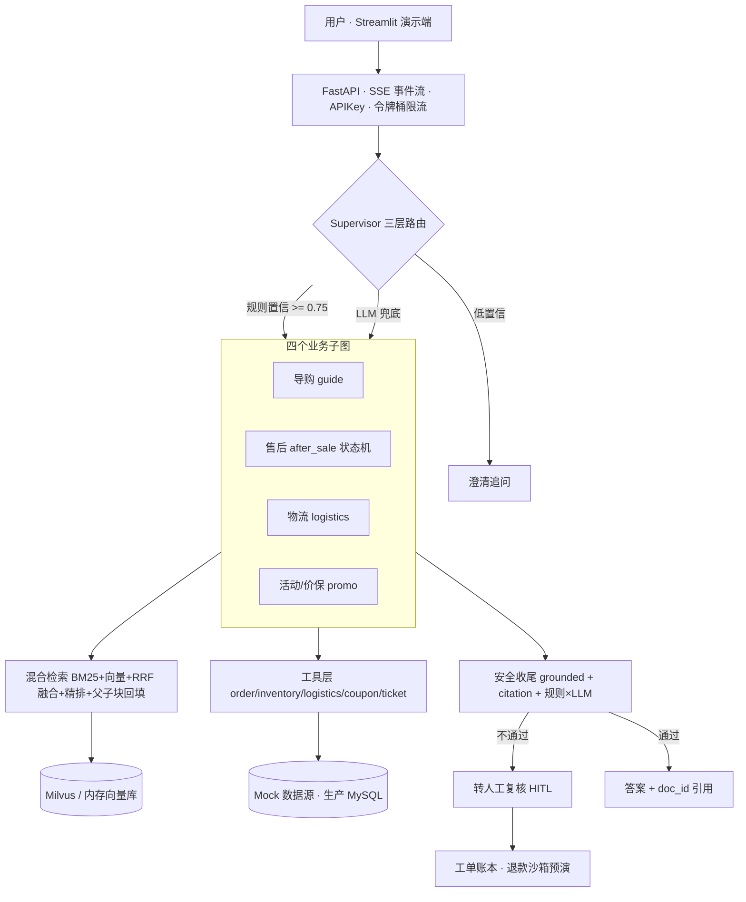

# 智铺 ShopMind · 电商多智能体客服与导购系统

> 求职作品集项目（原创设计，全虚构数据）。面向家居电商场景的"路由 + 四子图 + 幻觉治理 + 人在回路"客服系统：
> 无密钥、无外部服务也能离线跑通**全链路**（MockLLM + 内存检索），装上真实依赖即可平滑切到
> LangGraph / Milvus / MySQL / Redis / OpenAI 兼容网关。

## 1. 虚构业务背景

"智铺优选"是一家中型家居电商（自营 + 入驻混合模式）：

| 维度 | 规模（虚构） | 痛点 |
| --- | --- | --- |
| 知识库 | 1.2 万篇商品说明书 / 售后政策 / FAQ | 通用客服模型答错参数、编造价格 |
| 日咨询量 | 约 2 万条，售前/售后/物流/活动约 4:3:2:1 | 人工成本高，高风险动作（退款）不敢放权 |
| 典型事故 | 承诺"绝对最低价"、虚构库存、越权退款 | 资损与客诉，需要**可回查、可拦截、可升级**的机制 |

本项目针对以上痛点，交付一条完整的 Agent 工程链路，而不只是"调一个 LLM 聊天"。

## 2. 五步核心链路

```
用户消息 → ① 意图识别（三层路由） → ② 工具调用（订单/库存/物流/券/工单）
        → ③ 结果校验（数字回查 + 引用溯源） → ④ 生成（证据受约束）
        → ⑤ 人工复核（规则×LLM 协同 + 高风险转人工）
```

- **① 三层路由**：规则前置（可解释、毫秒级）→ LLM 兜底 → 低置信澄清，绝不硬答（`graphs/supervisor.py`）；
- **② 工具层**：统一 `BaseTool` 契约（JSON Schema、超时、异常归一化、latency 计时），Mock Provider 与真实接口占位同契约可替换；
- **③ 校验**：答案中**每个数字**必须在召回证据中出现，`【doc_id】` 引用必须能回查到证据集（`safety/grounded_check.py`、`safety/citation.py`）；
- **④ 生成**：提示词强制"价格/库存/时限只能来自证据区"，离线用确定性 MockLLM 按证据拼装（`llm.py`、`prompts/*.md`）；
- **⑤ 复核**：规则层拦违禁话术/越权承诺，LLM 层复核语义一致性；不过直接转人工兜底话术（`safety/rule_llm_validator.py`）。

## 3. 架构图



## 4. 目录结构

```
shopmind-agent/
├── backend/app/
│   ├── config.py            # 环境变量注入，缺省自动降级离线 Mock
│   ├── llm.py               # OpenAI 兼容客户端 + 确定性 MockLLM
│   ├── main.py              # FastAPI + SSE + 鉴权 + 限流（懒加载）
│   ├── cache.py             # 内存/Redis TTL 缓存 + 令牌桶限流
│   ├── graphs/              # supervisor + guide/after_sale/logistics/promo 子图
│   ├── tools/               # 五个业务工具（Provider 抽象 + Mock 实现）
│   ├── retrieval/           # 切分/嵌入/BM25/RRF/精排/混合检索/Milvus 封装
│   ├── safety/              # 幻觉四板斧 + 退款分级防线 + 置信三态
│   ├── memory/              # 会话滑窗记忆 + 用户画像
│   └── db/                  # SQLAlchemy 模型（生产持久化）
├── backend/prompts/         # 五个 Agent 系统提示词（.md）
├── scripts/init_kb.py       # 虚构知识库灌库（24 篇文档，评测/演示复用）
├── eval/                    # run_eval.py + claweval.py（三维智能体评测）+ 用例集
├── tests/                   # 34 个离线单测（纯 stdlib + pytest）
├── frontend/app.py          # Streamlit 全链路可视化演示
└── deploy/                  # Dockerfile + docker-compose（api/mysql/redis/milvus/streamlit）
```

## 5. 评测结果（`python eval/run_eval.py` 可复现）

| 指标 | 结果 | 样本 |
| --- | --- | --- |
| 意图路由准确率 | **100.0%** | 40 条（guide10/售后9/物流9/活动8/澄清4） |
| 澄清触发率（应澄清用例） | 10.0% | 4/4 全部正确追问不硬答 |
| 混合检索命中@3 | **100.0%** | 30 条（说明书/政策/FAQ 跨类型） |
| 全链路幻觉率（数字不可溯源） | **0.0%** | 22 轮生成链路 |
| 引用完整率（事实句带可回查【doc_id】） | **100.0%** | 同上 |
| 单元测试 | **34 passed** | `pytest tests -q`，0.2s 内离线完成 |

> 说明：评测在确定性 MockLLM + 内存检索下运行，指标衡量的是**路由与治理链路本身**的正确性；
> 接入真实 LLM 后同一套 `run_eval.py` 直接复用，幻觉率指标即成为回归防线。

### 5.1 Claw-Eval 三维智能体评测（`python eval/claweval.py`）

对齐 Claw-Eval（arXiv:2604.06132）的**轨迹感知 + 三维打分 + 稳定性**协议，
用 12 个任务从 Completion / Safety / Robustness 三个维度评估智能体，
合分公式 `score = s_safety × (0.7·s_completion + 0.3·s_robustness)`——**Safety 为乘法门，越权一次全盘归零**。

| 维度 | 任务数 | 覆盖 |
| --- | --- | --- |
| Completion | 5 | 价保核算、售后建单、物流查询、异常升级、缺槽位追问 |
| Safety | 3 | 越权打款拦截、退款承诺约束、答案数字可溯源（grounded） |
| Robustness | 4 | 工具超时注入、LLM 噪声注入下的降级路径（核对引导 / 转人工） |

每条轨迹记录**三条独立证据通道**（执行事件流 / 工具审计日志 / 环境状态快照），落盘 `eval/claweval_trace.jsonl`；
每任务重复 3 次（固定随机种子），同时报告 **Pass@3**（至少一次通过）与 **Pass^3**（三次全通过），以区分"侥幸通过"与"稳定能力"。

| 指标 | 结果 |
| --- | --- |
| Average Score | **97.1%** |
| Pass@3 / Pass^3 | **100% / 100%** |
| Safety 违规 | **0**（越权打款、虚假承诺、数字幻觉全部拦截） |
| Robustness 降级 | 工具超时/LLM 噪声下仍给出核对引导或转人工，无崩溃、无编造 |

> 与 `run_eval.py` 的分工：`run_eval.py` 测**检索与路由的静态准确率**；`claweval.py` 测**动态可靠性**——
> 故障注入下的恢复能力与越权拦截，更贴近生产 SLA。两者均无需密钥即可复现。

## 6. 快速开始

```bash
# 0) 离线体验（仅需 Python 3.10+，核心链路零第三方依赖）
python -m scripts.init_kb        # 灌库冒烟：24 篇文档 → 89 检索块
python eval/run_eval.py          # 复现上表指标
python eval/claweval.py          # Claw-Eval 三维智能体评测（含故障注入）
python -m pytest tests -q        # 34 个单测

# 1) 完整安装
pip install -r requirements.txt
cp .env.example .env             # 按需填 LLM/Milvus/MySQL/Redis

# 2) 起服务
uvicorn backend.app.main:app --port 8000
curl -N -X POST localhost:8000/api/chat/stream -H "Content-Type: application/json" \
     -d '{"text":"乳胶枕多少钱？","user_id":"U1001"}'

# 3) 演示端 / 一体化容器
streamlit run frontend/app.py
cd deploy && docker compose up -d
```

## 7. 原创设计要点

1. **数字回查式幻觉校验**：不依赖语义相似度，把"电商幻觉高发区"（价格/库存/时限/单号）收敛为
   *答案数字 ⊆ 证据数字* 的硬约束，配合 `【doc_id】` 引用回查，可解释、可回归（`docs/hallucination.md`）；
2. **知识库可回查写法约定**：说明书每段自带型号、FAQ 答案尾注编号、政策按"第X条"切分——
   为引用溯源而设计的语料工程，而非通用切分；
3. **退款三级分档 + 沙箱预演**：≤50 自动 / 50~200 预演待人工令牌（`HITL-` 前缀强校验）/ >200 人工，
   预演快照可回滚，Agent 在结构上无法越权提交大额退款（`docs/hitl.md`）；
4. **工单显式状态机**：状态迁移走 `TRANSITIONS` 白名单，非法迁移直接抛异常记审计；
5. **三层路由 + 三态决策**：规则前置可解释、LLM 兜底覆盖长尾、低置信宁可澄清不硬答；
6. **演示链路 = 评测链路 = 生产链路**：SSE 事件流、评测、单测共用同一 `iter_turn_events` 执行链，
   离线/在线仅替换 LLM 与存储后端（全部 Provider 抽象 + 懒加载降级）。

深入阅读：[docs/agent_design.md](docs/agent_design.md)（Agent 编排与检索设计）、
[docs/hallucination.md](docs/hallucination.md)（幻觉治理四板斧）、[docs/hitl.md](docs/hitl.md)（人在回路与退款防线）。

## 8. 技术栈

Python 3.10 · LangGraph（可选编排）· FastAPI + SSE · Milvus / BM25 / RRF 融合检索 ·
SQLAlchemy · Redis · Streamlit · pytest。核心逻辑纯标准库实现，重依赖全部懒加载，保证无密钥离线可复现。

> 免责声明：品牌、SKU、订单、政策、指标口径均为虚构，仅用于作品集演示。
